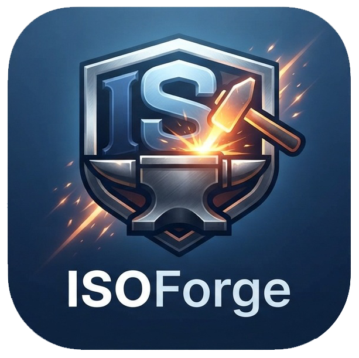

# ISOForge(ZR)



**A modern, lightweight Windows editor for ISO disc images and ZIP, 7Z, RAR and self-extracting archives — all with one open / edit / extract / save workflow.**

Version **2.8.1** · Python 3.13 · PySide6 · MIT License · © 2026 Vires IT Consultants

---

## Contents

- [Features](#features)
- [Supported formats](#supported-formats)
- [Installation](#installation)
- [Running from source](#running-from-source)
- [Using ISOForge](#using-isoforge)
- [Passwords and encryption](#passwords-and-encryption)
- [RAR support](#rar-support)
- [Self-extracting archives](#self-extracting-archives)
- [Windows Explorer integration](#windows-explorer-integration)
- [Command-line options](#command-line-options)
- [Building the installer](#building-the-installer)
- [Project structure](#project-structure)
- [How it works](#how-it-works)
- [Troubleshooting](#troubleshooting)
- [License](#license)

---

## Features

- **One editor, five container types.** You open, browse, edit and save ISO, ZIP, 7Z, RAR and SFX (.exe) files the same way.
- **Edit without touching the original.** You can add, rename, delete and reorganise files and folders in memory. Nothing is written to disk until you choose **Save**.
- **Convert between formats.** Open any supported file and use **Save As** to write it in another format, for example ISO to ZIP or RAR to 7Z.
- **Create from a folder.** The **Convert** wizard builds an ISO or archive straight from a folder on disk.
- **AES-256 encryption.** You can password-protect ZIP, 7Z and SFX output. RAR uses its own encryption, which hides file names too.
- **Large-file friendly.**
  - ISOs include UDF, so there is no 4 GB per-file limit.
  - ZIP switches to ZIP64 automatically for files over 2 GB.
  - 7Z streams data instead of loading whole files into memory.
- **Accurate progress with a working Cancel.** Progress is measured in bytes rather than file counts. Cancelling a save never damages the original file.
- **Safe saves.** Every build writes to a temporary file first and only replaces the target once it has finished successfully.
- **Explorer right-click menu.** Options include *Open*, *Extract Here*, *Extract to subfolder* and *Compress with ISOForge…*. If you select several files, they go into one archive.
- **Drag and drop.** Drop files or folders onto the file list to add them.
- **Light and dark themes.** Switch from the toolbar; your choice is remembered.
- **No hidden state.** Every launch starts with a blank project. ISOForge never reopens your last file by itself.

## Supported formats

| Format | Extensions | Open | Create | Encryption |
|---|---|---|---|---|
| ISO disc image | `.iso` | ✅ | ✅ | — (not part of the format) |
| ZIP | `.zip`, `.cbz` | ✅ | ✅ | AES-256 (reads ZipCrypto too) |
| 7-Zip | `.7z` | ✅ | ✅ | AES-256, file names hidden |
| RAR | `.rar`, `.cbr`, `.r00` | ✅ ¹ | ✅ ² | RAR `-hp` (file names hidden) |
| Self-extracting | `.exe` | ✅ | ✅ ³ | AES-256 (file names visible) |

¹ Needs `UnRAR.exe` or `Rar.exe`. ² Needs `Rar.exe`. ³ Needs an SFX stub module, such as 7-Zip's `7z.sfx`.
See [RAR support](#rar-support) and [Self-extracting archives](#self-extracting-archives).

When ISOForge saves an ISO, it uses the richest layout that succeeds and steps down only if it has to:

1. ISO9660 + Joliet + Rock Ridge + UDF 2.60
2. ISO9660 + Joliet + UDF 2.60
3. ISO9660 + UDF 2.60
4. ISO9660 + Joliet + Rock Ridge
5. ISO9660 + Joliet
6. ISO9660 only

If it falls back to a simpler layout, the status bar shows which one was used.

## Installation

### Installer (recommended)

1. Run `ISOForgeZR-Setup-<version>.exe`.
2. Optionally tick **Create a desktop shortcut** and **Add ISOForge to the Explorer right-click menu**.
3. Launch **ISOForge(ZR)** from the Start menu.

Uninstalling also removes the Explorer menu entries. Your existing file associations are never changed.

### Optional external tools

ISOForge can't bundle these for licensing reasons. Install them yourself if you need the matching feature:

| Tool | Enables | Source |
|---|---|---|
| `Rar.exe` | Creating (and reading) RAR | Ships with WinRAR |
| `UnRAR.exe` | Reading RAR | Ships with WinRAR |
| `7z.sfx` (or similar) | Creating self-extracting `.exe` | Ships with 7-Zip (free) |

ISOForge finds these tools automatically in three places:
- the ISOForge folder (or its `app` or `sfx` subfolder)
- anywhere on your `PATH`
- the standard `WinRAR` and `7-Zip` install folders

You can also set the paths under **Tools › Settings**.

## Running from source

Requirements: **Python 3.13** on Windows.

```bat
run.bat
```

The first time it runs, `run.bat` creates a `venv`, installs `requirements.txt` and starts the app. After that it just activates the venv and launches.

To set it up by hand:

```bat
python -m venv venv
venv\Scripts\activate
pip install -r requirements.txt
python main.py
```

### Python dependencies

| Package | Purpose |
|---|---|
| `PySide6` ≥ 6.5 | User interface; also provides QtNetwork for single-instance batching |
| `pycdlib` ≥ 1.14 | Reading and writing ISO images |
| `py7zr` ≥ 0.20 | Reading and writing 7Z, including AES-256 |
| `pyzipper` ≥ 0.3.6 | ZIP AES-256 encryption |
| `rarfile` ≥ 4.0 | Reading RAR, using UnRAR behind the scenes |

Every archive library is loaded only when it's needed. If one is missing, only that format stops working. Error messages name the exact `pip install` command to fix it.

## Using ISOForge

| Action | What it does |
|---|---|
| **New** | Starts an empty project |
| **Open** | Loads an `.iso`, `.zip`, `.7z`, `.rar`, `.exe`, `.cbz` or `.cbr` file |
| **Save / Save As** | Builds the final file. Save As can change the format |
| **Add Files / Add Folder** | Adds content from your computer to the project; drag and drop works too |
| **New Folder** | Creates an empty folder inside the project |
| **Rename (F2) / Delete** | Changes the project only; nothing on disk changes until you save |
| **Rename Disc…** | Sets the ISO volume label (ISO projects only) |
| **Extract** | Copies the selected items, or everything, to a folder |
| **Properties** | Shows sizes, file and folder counts, format and encryption |
| **Convert** | Creates an ISO or archive directly from a folder |
| **Settings (Ctrl+,)** | Sets tool paths and the Explorer menu |

Navigation works like Explorer: there's a folder tree, a file list, Back / Forward / Up / Refresh buttons, and a path bar you can type into.

## Passwords and encryption

- **Opening.** For an encrypted archive, ISOForge asks for the password and checks it straight away by decrypting a real file. A wrong password is caught right then, not halfway through extracting.
- **Saving.** For any format that supports encryption, ISOForge offers optional password protection. It's off by default.
- **Re-saving.** If the archive is already encrypted, ISOForge keeps the same password without asking again.
- **SFX note.** In self-extracting archives, file names are left readable on purpose so the stub can show its password prompt. File contents are still AES-256 encrypted.

## RAR support

The RAR compression algorithm belongs to RARLAB, so no open-source library may create RAR files. ISOForge works around this by running your own copy of RARLAB's command-line tool:

- **No tools:** RAR files can't be read or created.
- **`UnRAR.exe`:** RAR files can be opened and extracted.
- **`Rar.exe`:** RAR files can be opened, extracted and created, with optional encryption.

To build a RAR, ISOForge first copies the project into a temporary folder and then runs `Rar.exe` on it. This needs temporary disk space about equal to the uncompressed content. The temporary folder is always deleted afterwards, including after errors or a cancel.

> **Note:** RAR passwords are passed to `Rar.exe` on its command line, so other processes on the same machine may briefly be able to see them. Other RAR front-ends have the same limitation.

## Self-extracting archives

A self-extracting archive is a small **stub program** with an ordinary archive attached to the end. ISOForge builds the attached archive and joins the two together, the same way 7-Zip and WinRAR do.

ISOForge works out which archive format to attach from the stub's file name:

| Stub | Attached format |
|---|---|
| `7z.sfx`, `7zCon.sfx`, `7zS*.sfx` (7-Zip) | 7Z |
| `Zip.SFX`, `Zip64.SFX` (WinRAR) | ZIP |
| `Default.SFX`, `WinCon.SFX` (WinRAR) | RAR (needs `Rar.exe`) |

The result is still a normal archive: ISOForge, 7-Zip and WinRAR can all open it. ISOForge also opens self-extracting archives made by other programs.

## Windows Explorer integration

Turn it on during install, or under **Tools › Settings › Windows Explorer**.

```
Right-click a .zip / .7z / .rar / .iso / .cbz / .cbr
    ISOForge  ›  Open with ISOForge
                 Extract Here
                 Extract to subfolder

Right-click any file(s) or folder(s)
    ISOForge  ›  Compress with ISOForge...
```

- Entries are written under `HKEY_CURRENT_USER` only, so **no admin rights are needed** and existing file associations stay untouched.
- On **Windows 11** the menu appears under **Show more options** (Shift+F10).
- **Multiple selections** are grouped. Explorer starts one process per file, so the first instance collects the others for a short time and treats them as one action. Explorer caps this at 15 files by default.
- **Extract** runs in the background without opening the main window, then shows one summary at the end.
- **Compress** opens the window with your selection already added and a suggested name. You then choose the format with **Save As**.
- If the menu points at an old copy or uses an older layout, Settings tells you so and lets you re-apply it.

## Command-line options

```bat
ISOForgeZR.exe                         Start with a blank project
ISOForgeZR.exe --open "C:\path\file.7z"  Open a file on startup (-o)
ISOForgeZR.exe --register-shell        Add the Explorer menu (silent)
ISOForgeZR.exe --unregister-shell      Remove the Explorer menu (silent)
```

Explorer itself uses `--shell-open`, `--extract-here`, `--extract-to` and `--compress`. You won't normally type these.

## Building the installer

Requirements: Python 3.13 on your `PATH`, and **Inno Setup 6.3+** (`winget install JRSoftware.InnoSetup`).

From the project root:

```bat
build_installer.bat
```

The script:

1. checks that `build\isoforge.ico` exists and that ISOForge isn't running
2. creates or reuses `venv`, then installs `requirements.txt` and PyInstaller
3. builds `dist\ISOForgeZR\` from `ISOForgeZR.spec`
4. reads the version from `app\__init__.py`
5. compiles `installer\IsoForge.iss` with that version

Output: `installer\Output\ISOForgeZR-Setup-<version>.exe`

Add `nopause` to run it without the pause at the end, for automation.

To release a new version, change `__version__` in `app/__init__.py` (and `ISOForgeZR.pfproj` if you use it). The installer picks up the new version automatically.

## Project structure

```
ISOForgeZR/
├─ main.py                  Entry point
├─ run.bat                  Run from source (creates venv on first run)
├─ build_installer.bat      PyInstaller + Inno Setup build
├─ ISOForgeZR.spec          PyInstaller spec
├─ ISOForgeZR.pfproj        Packaging project profile
├─ requirements.txt
├─ LICENSE.txt
├─ build/isoforge.ico       Application icon
├─ installer/IsoForge.iss   Inno Setup script
└─ app/
   ├─ main_window.py        Main window, dialogs, actions, startup
   ├─ vfs.py                In-memory file tree + ForgeProject
   ├─ formats.py            Format registry and capability checks
   ├─ iso_backend.py        ISO reading/writing (pycdlib)
   ├─ archive_backend.py    ZIP / 7Z / RAR / SFX reading/writing
   ├─ rar_tools.py          Finds and runs Rar.exe / UnRAR.exe
   ├─ sfx_tools.py          Finds and checks SFX stubs
   ├─ diskscan.py           Adds local folders into the tree
   ├─ fileops.py            BuildResult, safe file replace, cancellation
   ├─ progress.py           Byte-accurate progress reporting
   ├─ workers.py            Background threads for long tasks
   ├─ shell_integration.py  Explorer menu registry entries
   ├─ shell_commands.py     Context-menu command handling
   ├─ single_instance.py    Groups per-file Explorer launches
   ├─ settings_store.py     Saves tool paths (QSettings)
   ├─ settings_dialog.py    Tools › Settings dialog
   ├─ password_dialog.py    Password prompts
   ├─ icons.py              Icons drawn in code (no image files)
   ├─ theme.py              Light / dark stylesheets
   └─ theme_toggle.py       Theme switch widget
```

## How it works

- **One shared file tree.** `vfs.py` holds a simple tree of files and folders. It doesn't care about formats; each entry just records where its data lives: new, on disk, inside an ISO, or inside an archive. That's why editing, progress and Save As work the same for every format.
- **Two matching backends.** `iso_backend` and `archive_backend` provide the same functions (open, read the contents, extract, build), so the UI has one code path per action rather than one per format.
- **Always rebuilt.** ISO and archive formats are hard to edit in place, so every save builds a fresh file from the tree.
- **Formats are enabled at runtime.** `formats.can_write()` asks the RAR and SFX tool modules whether their tools are available. The Save As list and Convert dialog update the moment a tool is configured.
- **Cancellation.** Cancelling raises a special signal that isn't treated as an ordinary error. It passes straight through each "skip this file and carry on" handler, so Cancel can never be mistaken for one bad file.

## Troubleshooting

| Symptom | Fix |
|---|---|
| "Requires the 'py7zr' / 'pyzipper' / 'rarfile' package" | `pip install <name>` in the venv, or rebuild with `build_installer.bat` |
| RAR won't open | Set `UnRAR.exe` or `Rar.exe` under **Tools › Settings**, or drop it into the ISOForge folder |
| RAR or `.exe` is missing from Save As | Configure `Rar.exe`, or install 7-Zip for an SFX stub |
| Archive menu missing in Explorer | On Windows 11, look under **Show more options**. Otherwise re-apply the menu in Settings |
| Cancel seems slow on a large build | Windows or your antivirus may still be finishing a large disk write. ISOForge explains this and stops as soon as it can |
| Some files were skipped on save | ISOForge lists them. They couldn't be read from the original file; everything else saved normally |
| Long-path warning (ISO) | Advisory only. The ISO still builds normally |

## License

ISOForge(ZR) is released under the **MIT License**. See [`LICENSE.txt`](LICENSE.txt).

It uses third-party open-source packages under their own licenses: PySide6 (LGPL), pycdlib (LGPL), py7zr (LGPL), pyzipper (MIT) and rarfile (ISC).

`Rar.exe`, `UnRAR.exe` and SFX stub modules are **not** included with ISOForge. They remain the property of their owners, and you're responsible for using them under their own licence terms.

---

**Vires IT Consultants** · [www.vires.co.za](https://www.vires.co.za)
